# DroneTV AI Support & Lead Assistant

DroneTV AI Support & Lead Assistant is a full-stack web application for a drone-training business. It gives visitors a premium public website, a conversational support assistant, and enquiry forms, while giving administrators a protected workspace for reviewing and managing leads.

The implemented workflow is:

```text
Visitor
  ├─ browses the public website
  ├─ asks Sky a question at /chatbot
  └─ submits an enquiry from a form or chat
          │
          ▼
Express REST API
  ├─ validates the request with Zod
  ├─ uses Gemini or the safe rule-based fallback
  └─ authenticates administrator-only operations with JWT
          │
          ▼
MongoDB / MongoDB Atlas
  ├─ admins
  ├─ enquiries
  └─ chat conversations
          │
          ▼
Protected admin dashboard
  ├─ live overview statistics
  └─ enquiry search, filtering, detail, status updates, and deletion
```

> **Implementation note:** The repository uses Next.js 16 App Router for the frontend. It does not use Vite or React Router. The documentation below reflects the code that is actually present.

## Table of contents

- [Project status](#project-status)
- [Features](#features)
- [Technology stack](#technology-stack)
- [Architecture](#architecture)
- [Repository structure](#repository-structure)
- [Prerequisites](#prerequisites)
- [Installation and setup](#installation-and-setup)
- [Environment variables](#environment-variables)
- [Database setup](#database-setup)
- [API documentation](#api-documentation)
- [Authentication and security](#authentication-and-security)
- [Running and testing](#running-and-testing)
- [Screenshots](#screenshots)
- [Troubleshooting](#troubleshooting)
- [Known limitations and future improvements](#known-limitations-and-future-improvements)
- [Assignment submission checklist](#assignment-submission-checklist)
- [Contribution workflow](#contribution-workflow)

## Project status

### Implemented

- Responsive public landing page at `/`
- Course catalogue at `/courses`
- Public contact page at `/contact`
- Standalone chatbot at `/chatbot`
- Legacy chatbot page at `/chat` remains in the frontend
- Google Gemini integration through the backend using `@google/genai`
- Safe rule-based chatbot fallback when Gemini is unavailable or not configured
- Anonymous, session-scoped chat history in the browser
- MongoDB persistence for chatbot conversations
- Public enquiry creation
- JWT-protected administrator login and enquiry management
- Live MongoDB-backed dashboard statistics
- MongoDB Atlas-compatible configuration
- Zod validation, Helmet, CORS, rate limiting, bounded JSON requests, and centralized error responses
- Backend unit tests for enquiry validation and rule-based chatbot behavior

### Not implemented or not verified in this repository

- No production deployment URL is configured.
- Selected public UI screenshots are included under `frontend/public/screenshots/`.
- No automated frontend end-to-end test suite is configured.
- No frontend `lint` script is defined.
- No admin UI for browsing persisted chatbot conversations is exposed.
- No streaming Gemini response implementation is present.
- No root-level package manifest or single-command monorepo runner is present.

## Features

### Public users

- Premium responsive homepage with courses, services, contact CTA, and floating Sky link.
- Header, hero, and floating chatbot actions route to `/chatbot`.
- Course catalogue and course enquiry navigation.
- Contact form with name, email, phone, course/service, and message fields.
- Homepage contact-form submissions are sent with `userType: "Other"`.
- Standalone `/chatbot` page with:
  - welcome message
  - user and assistant message bubbles
  - timestamps
  - suggested questions
  - Enter-to-send and send button
  - loading/typing state
  - friendly API failure handling
  - reset confirmation
  - session storage for the anonymous conversation ID and visible messages
  - embedded enquiry form
  - field-level validation and success/error states
- Predefined questions for services, training, contact, registration, student support, human support, and service interest.
- Gemini-powered answers when `GEMINI_API_KEY` is configured.
- Rule-based replies for common DroneTV topics and a helpful fallback for unknown questions.
- Public enquiry creation without login.

### Administrators

- `/admin/login` login page with email and password.
- `/admin/overview` protected dashboard with:
  - total enquiry count
  - status counts
  - source aggregation
  - seven-day activity aggregation
- `/admin/enquiries` protected enquiry management:
  - search by name, email, phone, and displayed course/service
  - user-type filter
  - status filter
  - detail drawer
  - status changes
  - delete confirmation
- Logout clears the browser JWT token and redirects to `/admin/login`.
- Admin API operations require a valid JWT with the `admin` role.

## Technology stack

### Frontend

| Technology | Purpose |
| --- | --- |
| Next.js `16.4.0` | React framework and App Router |
| React `19` | UI components and client-side state |
| TypeScript | Static typing |
| Tailwind CSS `4.3.3` | Utility-first styling |
| Axios | HTTP client in `frontend/lib/api.ts` |
| Lucide React | Interface icons |
| `@vercel/analytics` | Installed analytics package |
| `shadcn`, `@base-ui/react`, `class-variance-authority`, `clsx`, `tailwind-merge`, `tw-animate-css` | Installed UI and styling utilities |

Vite and React Router are **not** used by the current frontend.

### Backend

| Technology | Purpose |
| --- | --- |
| Node.js | Runtime |
| Express `4.21.2` | HTTP API |
| TypeScript | Backend source and build |
| Mongoose `8.9.5` | MongoDB models and queries |
| `@google/genai` `^2.28.0` | Server-side Gemini client |
| Zod | Request validation |
| `jsonwebtoken` | JWT creation and verification |
| `bcryptjs` | Admin password hashing |
| Helmet | Security headers |
| CORS | Frontend-origin restriction |
| `express-rate-limit` | API rate limiting |
| dotenv | Environment loading |
| Vitest | Backend tests |

## Architecture

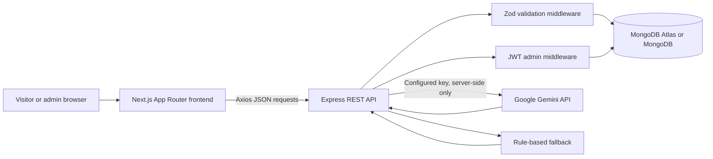

The frontend reads `NEXT_PUBLIC_API_URL` and sends JSON requests with Axios. The backend applies security middleware, validates input, authorizes administrator operations, and persists data through Mongoose. Gemini is called only from `backend/src/services/chatService.ts`; the browser never receives the Gemini API key.

## Repository structure

```text
.
├── README.md
├── backend/
│   ├── .env.example
│   ├── .gitignore
│   ├── package.json
│   ├── README.md
│   ├── tsconfig.json
│   ├── src/
│   │   ├── app.ts
│   │   ├── server.ts
│   │   ├── config/
│   │   │   ├── database.ts
│   │   │   └── env.ts
│   │   ├── controllers/
│   │   │   ├── authController.ts
│   │   │   ├── chatController.ts
│   │   │   ├── enquiryController.ts
│   │   │   └── statsController.ts
│   │   ├── middleware/
│   │   │   ├── asyncHandler.ts
│   │   │   ├── auth.ts
│   │   │   ├── errorHandler.ts
│   │   │   └── validate.ts
│   │   ├── models/
│   │   │   ├── Admin.ts
│   │   │   ├── ChatConversation.ts
│   │   │   └── Enquiry.ts
│   │   ├── routes/
│   │   │   ├── authRoutes.ts
│   │   │   ├── chatRoutes.ts
│   │   │   ├── enquiryRoutes.ts
│   │   │   └── statsRoutes.ts
│   │   ├── scripts/
│   │   │   └── seedAdmin.ts
│   │   ├── services/
│   │   │   └── chatService.ts
│   │   └── validations/
│   │       ├── auth.ts
│   │       ├── chat.ts
│   │       └── enquiry.ts
│   └── tests/
│       ├── chat.test.ts
│       └── validation.test.ts
└── frontend/
    ├── .env.example
    ├── .gitignore
    ├── package.json
    ├── pnpm-lock.yaml
    ├── app/
    │   ├── page.tsx
    │   ├── courses/page.tsx
    │   ├── contact/page.tsx
    │   ├── chat/page.tsx
    │   ├── chatbot/page.tsx
    │   └── admin/
    │       ├── layout.tsx
    │       ├── page.tsx
    │       ├── login/page.tsx
    │       ├── overview/page.tsx
    │       └── enquiries/page.tsx
    ├── components/
    │   ├── admin-shell.tsx
    │   ├── chatbot-page.tsx
    │   ├── public-shell.tsx
    │   └── ui/button.tsx
    ├── lib/api.ts
    └── public/
```

### Important backend responsibilities

- `app.ts`: Express configuration, Helmet, CORS, JSON size limit, rate limit, route registration, health endpoint, and error handling.
- `server.ts`: database connection, startup administrator provisioning, and HTTP server startup.
- `routes/`: endpoint-to-controller mapping and route-level authentication/validation.
- `controllers/`: request handling and database orchestration.
- `models/`: Mongoose schemas for admins, enquiries, and chat conversations.
- `middleware/auth.ts`: verifies `Bearer` JWTs and requires the `admin` role.
- `middleware/validate.ts`: parses Zod schemas for request body or query input.
- `services/chatService.ts`: Gemini integration, system instruction, rule-based fallback, timeout handling, and chat enquiry creation.
- `scripts/seedAdmin.ts`: explicitly creates or rotates the configured administrator using backend environment variables.

## Prerequisites

- Node.js compatible with the installed Next.js 16 and TypeScript dependencies. Node.js 20 LTS or newer is recommended.
- npm. The frontend declares `pnpm@12.3.4` in `package.json` and includes `pnpm-lock.yaml`; use pnpm for the most reproducible frontend install, or npm if that is your local workflow.
- MongoDB Atlas account or a compatible MongoDB instance.
- Git.
- A Google AI Studio Gemini API key for Gemini responses. The application still has a rule-based fallback when the key is omitted.

## Installation and setup

### 1. Clone and enter the project

```powershell
git clone <your-repository-url>
cd FullStack_Chatbot_Task_Piyush_Datt
```

macOS/Linux:

```bash
git clone <your-repository-url>
cd FullStack_Chatbot_Task_Piyush_Datt
```

Replace `<your-repository-url>` with the repository URL after it is published. No deployment URL is currently configured in this project.

### 2. Install backend dependencies

```powershell
cd backend
npm install
```

```bash
cd backend
npm install
```

### 3. Install frontend dependencies

From the project root:

```powershell
cd frontend
pnpm install
```

If pnpm is not installed:

```powershell
npm install
```

The same commands work on macOS/Linux.

### 4. Configure environment files

```powershell
Copy-Item backend\.env.example backend\.env
Copy-Item frontend\.env.example frontend\.env.local
```

macOS/Linux:

```bash
cp backend/.env.example backend/.env
cp frontend/.env.example frontend/.env.local
```

Edit the copied files with your own MongoDB URI, long JWT secret, frontend origin, administrator values, and optional Gemini key. Never commit either environment file.

### 5. Configure MongoDB

Follow the [MongoDB Atlas setup](#database-setup) section, then set `MONGODB_URI` in `backend/.env`.

### 6. Create or rotate the administrator

The backend also provisions the configured administrator during startup if it does not exist. To explicitly seed or rotate it:

```powershell
cd backend
npm run seed:admin
```

This reads `ADMIN_NAME`, `ADMIN_EMAIL`, and `ADMIN_PASSWORD` from `backend/.env` and stores a bcrypt hash, not plaintext.

### 7. Start the backend

```powershell
cd backend
npm run dev
```

The configured default port is `5000`. Verify it with:

```powershell
Invoke-RestMethod http://localhost:5000/api/health
```

### 8. Start the frontend

In a second terminal:

```powershell
cd frontend
pnpm dev
```

Or:

```powershell
npm run dev
```

Open:

- Public site: `http://localhost:3000`
- Chatbot: `http://localhost:3000/chatbot`
- Admin login: `http://localhost:3000/admin/login`

## Environment variables

### Backend: `backend/.env`

| Variable | Required | Purpose | Safe example |
| --- | --- | --- | --- |
| `PORT` | No | Express listening port; defaults to `5000`. | `5000` |
| `MONGODB_URI` | Yes | MongoDB connection string. | `mongodb+srv://<user>:<password>@<cluster>/<database>` |
| `JWT_SECRET` | Yes | JWT signing secret; validation requires at least 32 characters. | `replace-with-a-long-random-secret` |
| `JWT_EXPIRES_IN` | No | JWT lifetime passed to `jsonwebtoken`. | `8h` |
| `GEMINI_API_KEY` | No | Server-only Google Gemini API key. If absent, fallback chat behavior is used. | `replace-with-your-gemini-api-key` |
| `GEMINI_MODEL` | No | Gemini model name. | `gemini-2.5-flash` |
| `FRONTEND_ORIGIN` | Yes | Allowed browser origin for CORS. | `http://localhost:3000` |
| `ADMIN_EMAIL` | Yes | Administrator email used by startup provisioning and the seed script. | `admin@example.com` |
| `ADMIN_NAME` | No | Administrator display name. | `DroneTV Admin` |
| `ADMIN_PASSWORD` | Yes | Source password for provisioning/seed; validation requires at least 8 characters. | `replace-with-a-development-password` |
| `RATE_LIMIT_WINDOW_MS` | No | Global rate-limit window. | `900000` |
| `RATE_LIMIT_MAX` | No | Maximum requests per rate-limit window. | `100` |

### Frontend: `frontend/.env.local`

| Variable | Required | Purpose | Safe example |
| --- | --- | --- | --- |
| `NEXT_PUBLIC_API_URL` | No | Backend API base URL; defaults to `http://localhost:5000/api`. | `http://localhost:5000/api` |

`NEXT_PUBLIC_*` variables are exposed to the browser. Never place `JWT_SECRET`, `MONGODB_URI`, `ADMIN_PASSWORD`, or `GEMINI_API_KEY` in the frontend environment.

### Safe templates

The repository contains matching templates:

- [`backend/.env.example`](./backend/.env.example)
- [`frontend/.env.example`](./frontend/.env.example)

They contain placeholders only. Real credentials and connection strings must remain in ignored local `.env` files or a deployment secret manager.

## Database setup

1. Create a MongoDB Atlas account and cluster, or start a compatible local MongoDB instance.
2. Create a database user with a strong password.
3. Add the development machine's IP address under Atlas **Network Access**. For production, use a restricted network policy rather than an unrestricted allow-list.
4. Copy the driver connection string and replace its placeholders.
5. Set the complete string as `MONGODB_URI` in `backend/.env`.
6. Start the backend and call `GET /api/health`. A successful server start means the startup database connection and administrator provisioning completed.

### Collections and schemas

#### `admins`

Defined in `backend/src/models/Admin.ts`.

- `name`: required string
- `email`: required, unique, lowercase, trimmed string
- `passwordHash`: required bcrypt hash
- `role`: currently limited to `admin`
- `createdAt`, `updatedAt`: Mongoose timestamps

#### `enquiries`

Defined in `backend/src/models/Enquiry.ts`.

- `name`: required, trimmed, 2–100 characters
- `email`: required, trimmed, lowercase, maximum 254 characters
- `phone`: required, maximum 30 characters; Zod also validates allowed phone characters and length
- `userType`: `Student`, `Customer`, or `Other`
- `serviceOrCourse`: required, maximum 150 characters
- `message`: required, maximum 5,000 characters
- `status`: `New`, `Contacted`, `In Progress`, or `Closed`; defaults to `New`
- `source`: `Chatbot` or `Contact Form`
- `createdAt`, `updatedAt`: Mongoose timestamps

Indexes exist on `email`, the compound `{ status, userType }`, and text fields `{ name, email, phone }`.

#### `chatconversations`

Defined in `backend/src/models/ChatConversation.ts`.

- `conversationId`: required, unique, indexed anonymous browser-session identifier
- `messages`: embedded messages with:
  - `role`: `user` or `assistant`
  - `content`: required, maximum 2,000 characters
  - `createdAt`
- top-level `createdAt`, `updatedAt` timestamps

Chat conversations are persisted, but there is currently no administrator endpoint or dashboard screen for browsing them.

## API documentation

The backend is mounted at `http://localhost:5000/api` by default. Successful responses use a `data` property. Validation errors return `error` and, where applicable, `details`.

### Endpoint summary

| Method | Endpoint | Purpose | Authentication | Body/query |
| --- | --- | --- | --- | --- |
| `GET` | `/api/health` | Health response | Public | None |
| `POST` | `/api/auth/login` | Authenticate an administrator | Public | `{ email, password }` |
| `POST` | `/api/enquiries` | Create a public enquiry | Public | `name`, `email`, `phone`, `userType`, `serviceOrCourse`, `message`, `source` |
| `GET` | `/api/enquiries` | List enquiries | Admin JWT | Optional `search`, `userType`, `status`, `page`, `limit` |
| `GET` | `/api/enquiries/:id` | Retrieve one enquiry | Admin JWT | MongoDB enquiry ID |
| `PATCH` | `/api/enquiries/:id` | Update enquiry fields, commonly status | Admin JWT | At least one valid enquiry field |
| `DELETE` | `/api/enquiries/:id` | Delete an enquiry | Admin JWT | MongoDB enquiry ID |
| `POST` | `/api/chat` | Get a Sky response and persist chat messages | Public | `message`, optional `conversationId`, `history`, `enquiry` |
| `GET` | `/api/stats` | Get dashboard aggregates | Admin JWT | None |

All requests are subject to the global rate limiter. JSON request bodies are limited to 32 KB.

### Login

```bash
curl -X POST http://localhost:5000/api/auth/login \
  -H "Content-Type: application/json" \
  -d '{
    "email": "admin@example.com",
    "password": "replace-with-your-password"
  }'
```

Success shape:

```json
{
  "data": {
    "token": "<jwt>",
    "admin": {
      "id": "<mongo-id>",
      "email": "admin@example.com",
      "role": "admin"
    }
  }
}
```

### Create an enquiry

```bash
curl -X POST http://localhost:5000/api/enquiries \
  -H "Content-Type: application/json" \
  -d '{
    "name": "Aarav Kumar",
    "email": "aarav@example.com",
    "phone": "+91 98765 43210",
    "userType": "Other",
    "serviceOrCourse": "Drone Pilot Training",
    "message": "Please share the next available batch.",
    "source": "Contact Form"
  }'
```

The homepage intentionally submits `userType: "Other"`. Chatbot enquiries can use `Student`, `Customer`, or `Other` and use `source: "Chatbot"`.

### Chat

```bash
curl -X POST http://localhost:5000/api/chat \
  -H "Content-Type: application/json" \
  -d '{
    "message": "What drone training courses are available?",
    "conversationId": "browser-session-id-1234",
    "history": [
      { "role": "user", "text": "Hello" },
      { "role": "assistant", "text": "Hi, I am Sky." }
    ]
  }'
```

Chat history is limited to 20 messages and individual message text is limited to 2,000 characters. The response includes `reply`, `provider` (`gemini` or `fallback`), `retryable`, and `conversationId`.

### Chat with an enquiry

```json
{
  "message": "I want to speak with admissions.",
  "enquiry": {
    "name": "Aarav Kumar",
    "email": "aarav@example.com",
    "phone": "+91 98765 43210",
    "userType": "Student",
    "serviceOrCourse": "Drone Pilot Training",
    "message": "Please contact me about the next batch."
  }
}
```

The chat controller persists the chat messages and creates a `New` enquiry with `source: "Chatbot"`.

### List, search, and filter enquiries

```bash
curl "http://localhost:5000/api/enquiries?search=aarav&userType=Other&status=New&page=1&limit=20" \
  -H "Authorization: Bearer <admin-jwt>"
```

The response contains `data` and pagination metadata: `page`, `limit`, `total`, and `pages`.

### Retrieve one enquiry

```bash
curl http://localhost:5000/api/enquiries/<enquiry-id> \
  -H "Authorization: Bearer <admin-jwt>"
```

### Update status

```bash
curl -X PATCH http://localhost:5000/api/enquiries/<enquiry-id> \
  -H "Authorization: Bearer <admin-jwt>" \
  -H "Content-Type: application/json" \
  -d '{ "status": "Contacted" }'
```

Valid statuses are `New`, `Contacted`, `In Progress`, and `Closed`.

### Delete an enquiry

```bash
curl -X DELETE http://localhost:5000/api/enquiries/<enquiry-id> \
  -H "Authorization: Bearer <admin-jwt>"
```

Successful deletion returns HTTP `204`.

### Dashboard statistics

```bash
curl http://localhost:5000/api/stats \
  -H "Authorization: Bearer <admin-jwt>"
```

The response contains total enquiries, status counts, source aggregates, and activity grouped by date for the last seven days.

### Common responses

| Status | Meaning |
| --- | --- |
| `201` | Public enquiry created |
| `204` | Enquiry deleted |
| `400` | Invalid body, query, or enquiry ID |
| `401` | Missing, invalid, or expired JWT |
| `403` | Valid token without administrator access |
| `404` | Route or enquiry not found |
| `409` | Duplicate administrator email during a database write |
| `429` | Rate limit exceeded |
| `500` | Safe unexpected server error response |

## Authentication and security

- Administrators log in through `POST /api/auth/login`.
- Passwords are hashed with `bcryptjs` using a work factor of 12 by the seed/startup provisioning flow.
- The API returns a JWT signed with `JWT_SECRET`; the frontend stores the token in `localStorage` under `dronetv_admin_token`.
- Protected enquiry and statistics routes require `Authorization: Bearer <token>`.
- JWT verification requires the `admin` role and rejects invalid or expired tokens.
- Zod validates body and query input before controllers run.
- Mongoose validators provide a second persistence-level validation layer.
- Helmet adds security headers.
- CORS is restricted to the configured `FRONTEND_ORIGIN`.
- Express JSON bodies are limited to 32 KB.
- A global `express-rate-limit` limiter uses `RATE_LIMIT_WINDOW_MS` and `RATE_LIMIT_MAX`.
- Centralized error handling returns friendly error messages without exposing stack traces or provider internals.
- Gemini calls run only on the backend.
- The chatbot has a provider timeout and safe fallback behavior.

Do not commit `.env`, `.env.local`, MongoDB credentials, JWT secrets, administrator passwords, or Gemini API keys. The currently configured local credentials are intentionally not documented here.

## Running and testing

### Development

Backend:

```bash
cd backend
npm run dev
```

Frontend:

```bash
cd frontend
pnpm dev
# or: npm run dev
```

### Production builds

Backend:

```bash
cd backend
npm run build
npm start
```

Frontend:

```bash
cd frontend
pnpm build
pnpm start
```

The frontend package has `dev`, `build`, and `start` scripts only. It does not define a lint script.

### Backend tests

```bash
cd backend
npm test
```

The current Vitest suite covers valid/invalid enquiry schemas and the rule-based chatbot service. There are no configured frontend tests or browser end-to-end tests.

### Manual verification checklist

1. Start MongoDB and the backend.
2. Confirm `GET /api/health`.
3. Open `/chatbot`, send a suggested question, send an unknown question, and reset the conversation.
4. Submit a valid chatbot enquiry and confirm it appears in MongoDB.
5. Open `/admin/login`, authenticate, and verify `/admin/overview`.
6. Search/filter enquiries at `/admin/enquiries`.
7. Open an enquiry detail, change its status, and test delete confirmation.

## Screenshots

The following public interface screenshots are included in the repository:

### Homepage


### Courses


### Services and studio preview

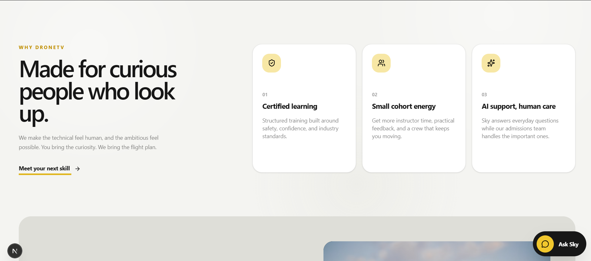


### Chatbot

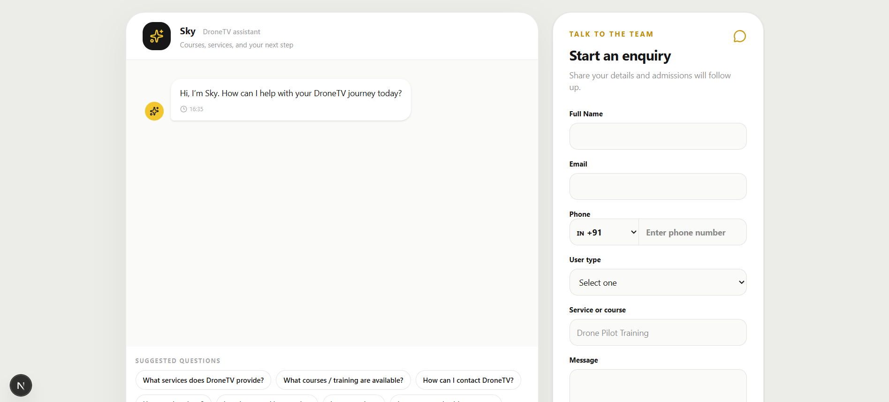

### Contact form

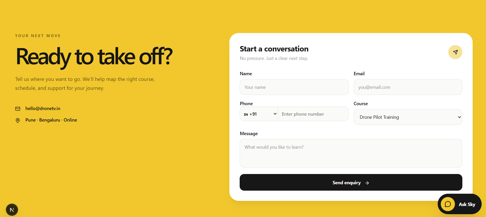

### Admin login

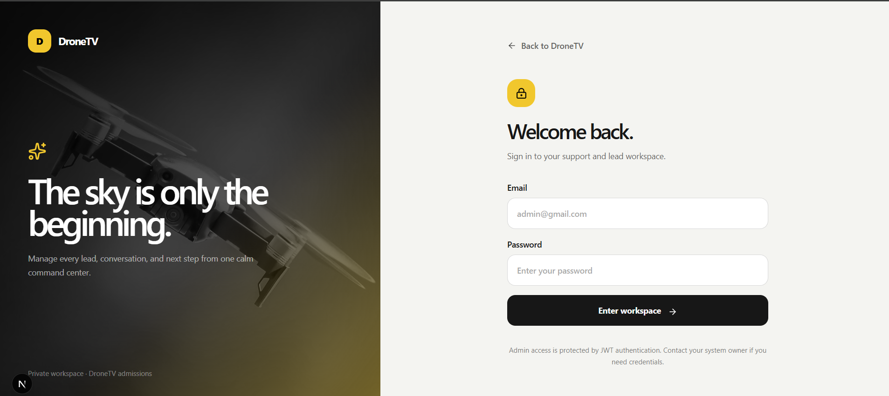

### Admin overview

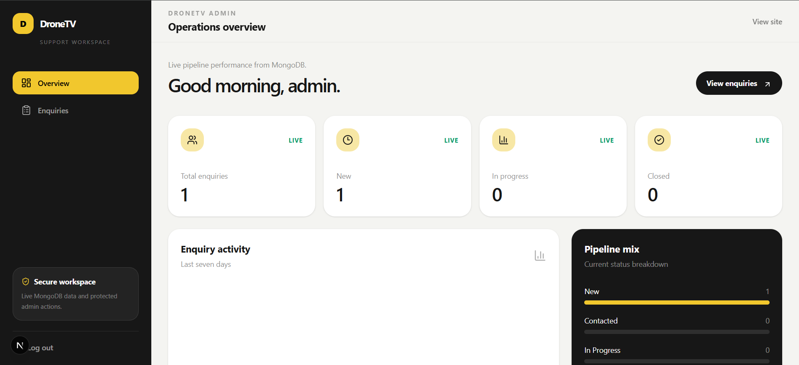

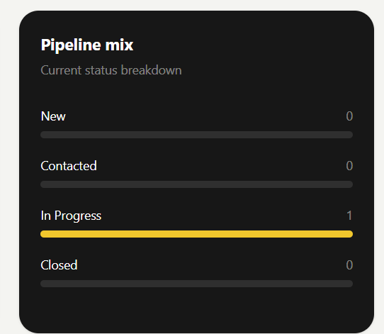

### Enquiry management

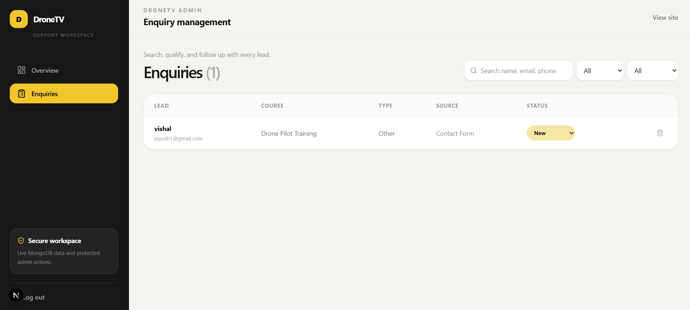

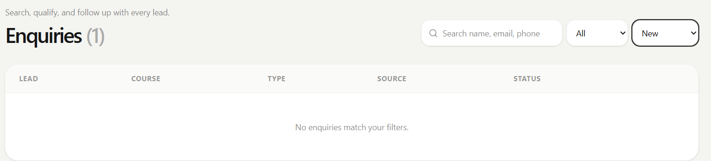

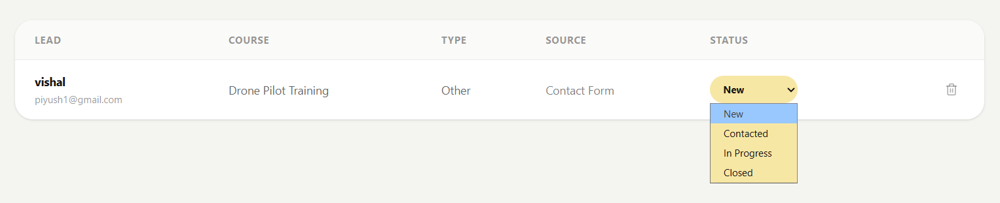

### Enquiry details

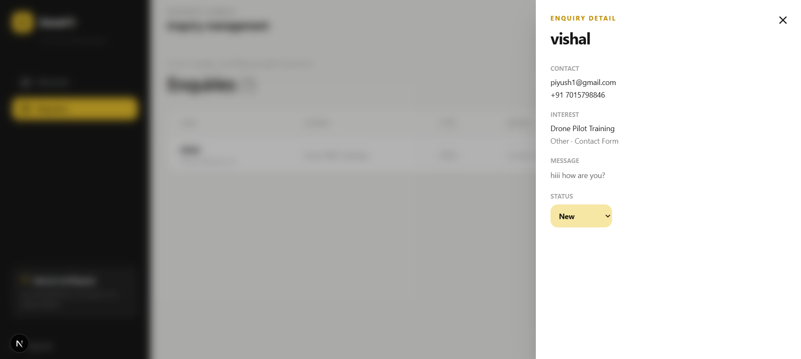

## Troubleshooting

### Missing or invalid environment configuration

The backend validates its environment on startup. Check that required values exist, that `JWT_SECRET` is at least 32 characters, that `ADMIN_PASSWORD` is at least 8 characters, and that `FRONTEND_ORIGIN` is a valid URL.

### CORS errors

Ensure `FRONTEND_ORIGIN` exactly matches the browser origin, including protocol and port. For local development it should normally be `http://localhost:3000`.

### MongoDB connection failure

Check the Atlas URI, database-user credentials, IP allow-list, network connection, and special-character URL encoding in the password. Start the backend again and inspect its startup error.

### Admin login failure

Run `npm run seed:admin` in `backend` after updating the local admin environment values. Confirm that the frontend `NEXT_PUBLIC_API_URL` points to the running backend API.

### Gemini quota or provider errors

The backend catches Gemini failures and returns a friendly fallback response with `provider: "fallback"` and `retryable: true`. Verify the API key, configured model, quota, and network access. The rule-based fallback remains available when Gemini is not configured.

### Frontend cannot reach the API

Start the backend first and check `frontend/.env.local`. Restart the Next.js dev server after changing environment variables.

## Known limitations and future improvements

- Add frontend component and end-to-end tests.
- Add a dedicated authenticated endpoint and admin screen for persisted chat conversations.
- Add a production deployment configuration and CI workflow.
- Add a health/readiness distinction for database availability.
- Consider secure, httpOnly cookie-based session handling instead of `localStorage` for production deployments.
- Add structured logging and monitoring for production operations.
- Add pagination controls to the admin UI; the backend already returns pagination metadata.
- Add streaming Gemini responses if they can be introduced without compromising timeout and fallback behavior.
- Add image assets and a documented screenshot gallery.

These are future improvements, not claims about currently implemented behavior.

## Assignment submission checklist

Use this checklist for the IPAGE Group assignment submission:

- [ ] Complete frontend and backend source code
- [ ] MongoDB Atlas setup and schema instructions
- [ ] API endpoint documentation and sample requests
- [ ] Screenshots of the homepage, chatbot, forms, and admin workspace
- [ ] GitHub repository link
- [ ] 5–10 minute video walkthrough
- [ ] Updated resume in PDF format
- [ ] Google Drive submission folders organized according to the assignment instructions

## Contribution workflow

1. Create a feature branch.
2. Keep frontend and backend changes scoped to the relevant package.
3. Do not commit environment files or user data.
4. Run the backend build and tests after backend changes.
5. Run the frontend type-check/build after frontend changes.
6. Update this README when routes, scripts, environment variables, or public behavior change.
7. Open a pull request with a concise summary and verification steps.
